<p align="center">
  <picture>
    <source media="(prefers-color-scheme: dark)" srcset="docs/media/nuka-logo-light.png">
    
  </picture>
</p>

<h1 align="center">Nuka-Physics</h1>

<p align="center">
  <strong>GPU-resident CUDA physics for robot learning.</strong><br>
  One block-descent solver for articulated robots, rigid bodies, VBD cloth, and MLS-MPM solids.
</p>

<p align="center">
  
  
  
</p>

<p align="center">
  <a href="#quick-start">Quick start</a> ·
  <a href="examples/demo/README.md">Run the demos</a> ·
  <a href="docs/getting-started.md">Documentation</a> ·
  <a href="#architecture">Architecture</a>
</p>

<table align="center" width="100%">
<tr>
<td width="50%" align="center" valign="top">
  <a href="https://github.com/kry4r/Nuka-Physics/raw/master/docs/media/pi05_libero.mp4">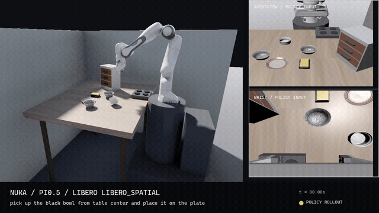</a>
  <br><b>π0.5 Inference</b>
  <br>Vision-language-action · LIBERO pick and place
  <br><a href="https://github.com/kry4r/Nuka-Physics/raw/master/docs/media/pi05_libero.mp4">Full video</a> · <a href="examples/demo/README.md#pi05-inference">Run demo</a>
</td>
<td width="50%" align="center" valign="top">
  <a href="https://github.com/kry4r/Nuka-Physics/raw/master/docs/media/g1_dance.mp4">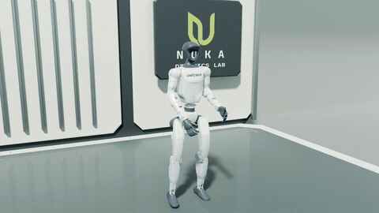</a>
  <br><b>G1 Dance</b>
  <br>29-DoF humanoid · Shuffle policy inference
  <br><a href="https://github.com/kry4r/Nuka-Physics/raw/master/docs/media/g1_dance.mp4">Full video</a> · <a href="examples/demo/README.md#g1-dance">Run demo</a>
</td>
</tr>
<tr>
<td width="50%" align="center" valign="top">
  <a href="https://github.com/kry4r/Nuka-Physics/raw/master/docs/media/nuka_go2_backflip.mp4">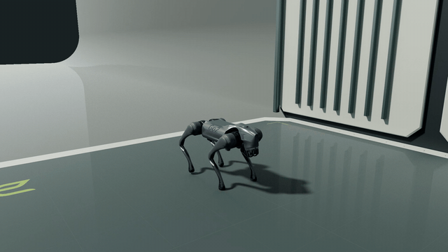</a>
  <br><b>Go2 Backflip</b>
  <br>TorchScript policy inference
  <br><a href="https://github.com/kry4r/Nuka-Physics/raw/master/docs/media/nuka_go2_backflip.mp4">1080p video</a>
</td>
<td width="50%" align="center" valign="top">
  <a href="https://github.com/kry4r/Nuka-Physics/raw/master/docs/media/nuka_go2_front_handstand.mp4">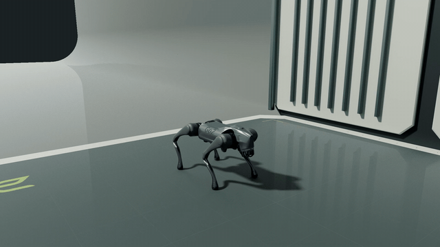</a>
  <br><b>Go2 Handstand</b>
  <br>TorchScript policy inference
  <br><a href="https://github.com/kry4r/Nuka-Physics/raw/master/docs/media/nuka_go2_front_handstand.mp4">1080p video</a>
</td>
</tr>
<tr>
<td width="50%" align="center" valign="top">
  <a href="https://github.com/kry4r/Nuka-Physics/raw/master/docs/media/elastoplastic_compression.mp4">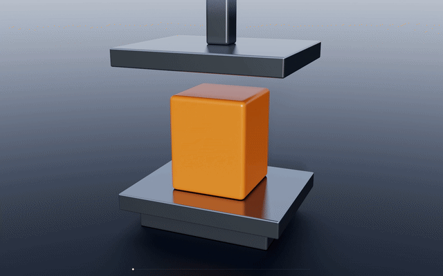</a>
  <br><b>Elastoplastic Compression</b>
  <br>Elastic recovery · Permanent deformation
  <br><a href="https://github.com/kry4r/Nuka-Physics/raw/master/docs/media/elastoplastic_compression.mp4">Full video</a> · <a href="examples/demo/README.md#elastoplastic-compression">Run demo</a>
</td>
<td width="50%" align="center" valign="top">
  <a href="https://github.com/kry4r/Nuka-Physics/raw/master/docs/media/elastoplastic_bunny.mp4">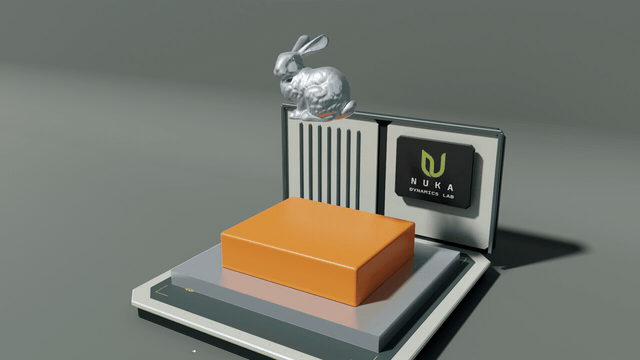</a>
  <br><b>Bunny × Elastoplastic</b>
  <br>Free fall · Plastic indentation · Real time
  <br><a href="https://github.com/kry4r/Nuka-Physics/raw/master/docs/media/elastoplastic_bunny.mp4">1080p video</a> · <a href="examples/demo/README.md#bunny-elastoplastic-impact">Run demo</a>
</td>
</tr>
<tr>
<td width="50%" align="center" valign="top">
  <a href="https://github.com/kry4r/Nuka-Physics/raw/master/docs/media/bunny_water_drop.mp4">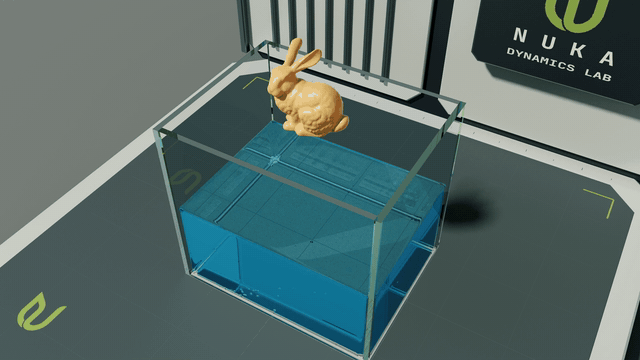</a>
  <br><b>Bunny × Water</b>
  <br>Two-way MLS-MPM coupling · 2× slow motion
  <br><a href="https://github.com/kry4r/Nuka-Physics/raw/master/docs/media/bunny_water_drop.mp4">1080p video</a> · <a href="examples/demo/README.md#bunny-water-drop">Run demo</a>
</td>
<td width="50%" align="center" valign="top">
  <a href="https://github.com/kry4r/Nuka-Physics/raw/master/docs/media/jelly_ball_drop.mp4">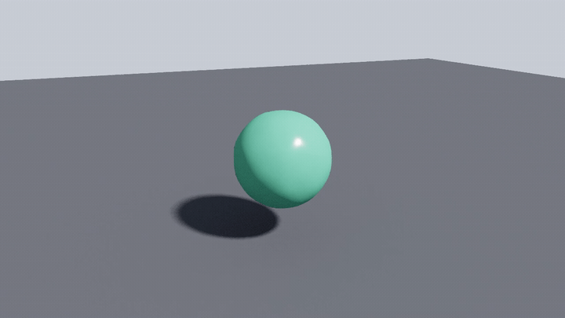</a>
  <br><b>Elastic Jelly</b>
  <br>MLS-MPM elasticity
  <br><a href="https://github.com/kry4r/Nuka-Physics/raw/master/docs/media/jelly_ball_drop.mp4">Full video</a>
</td>
</tr>
<tr>
<td width="50%" align="center" valign="top">
  <a href="https://github.com/kry4r/Nuka-Physics/raw/master/docs/media/microduck_ball_dynamic_lab.mp4">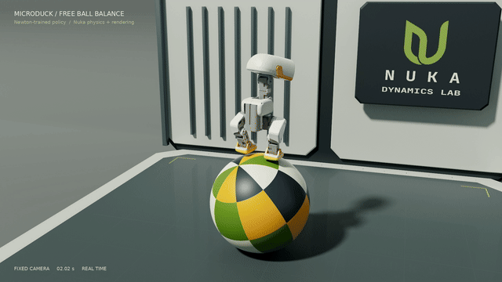</a>
  <br><b>Microduck Ball Balance</b>
  <br>Pure Nuka Physics RL
  <br><a href="https://github.com/kry4r/Nuka-Physics/raw/master/docs/media/microduck_ball_dynamic_lab.mp4">1080p video</a>
</td>
<td width="50%" align="center" valign="top">
  <a href="https://github.com/kry4r/Nuka-Physics/raw/master/docs/media/robot_elastoplastic.mp4">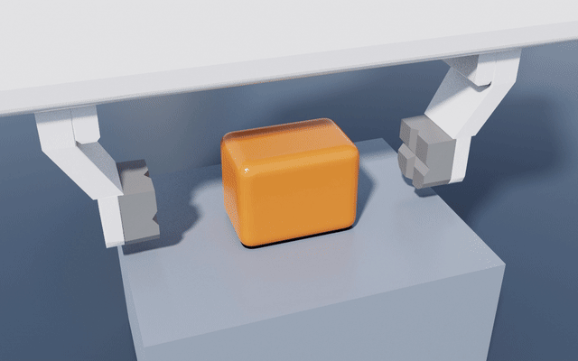</a>
  <br><b>Panda × Elastoplastic</b>
  <br>Dynamic gripper · Visual preview
  <br><a href="https://github.com/kry4r/Nuka-Physics/raw/master/docs/media/robot_elastoplastic.mp4">Full video</a> · <a href="https://github.com/kry4r/Nuka-Physics/raw/master/docs/media/robot_elastoplastic_close.mp4">Close-up</a> · <a href="examples/demo/README.md#dynamic-elastoplastic-gripper">Run demo</a>
</td>
</tr>
</table>

Material demos load the shared [Nuka Dynamics Lab assets](docs/nuka-stage.md), with a layered experiment deck, warm grey panels and avocado green accents. Layouts, materials, lights and cameras are editable in NKS. Existing gallery recordings retain their recorded environment and physics. The Microduck clip replays recorded Nuka physics with a Newton-trained balancing policy on a freely moving ball.

## Why Nuka

- **GPU-resident at scale.** One cooked world template drives thousands of independent environments on one GPU.
- **One solver.** Robot, rigid, cloth, and MLS-MPM contacts all run through one unified block-descent (UABD) solve.
- **Self-written stack.** CUDA physics, importers, Vulkan rendering, and a CUDA path tracer, with no external physics or rendering SDK.

## Architecture

<p align="center">
  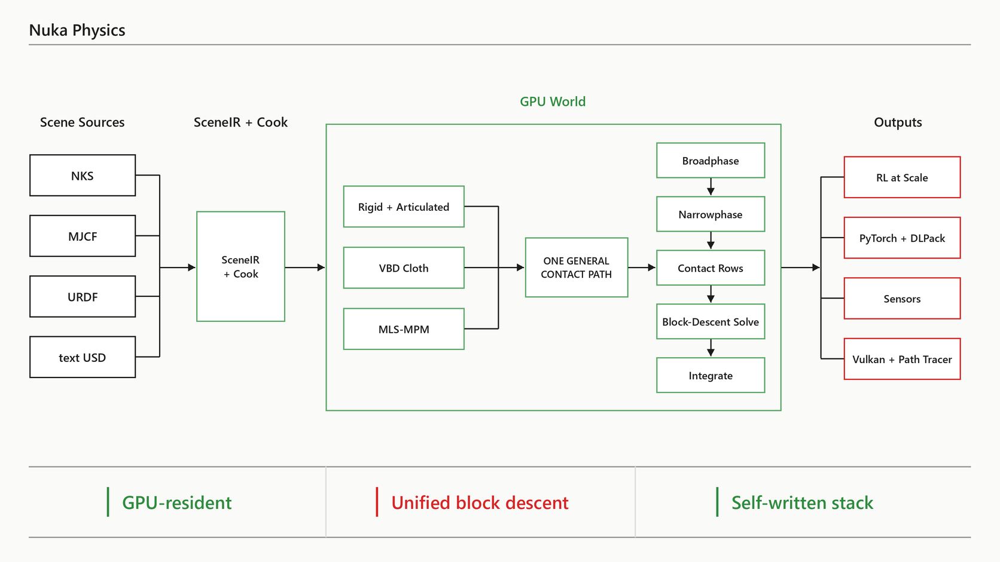
</p>

| Layer | Core modules | Responsibility |
| --- | --- | --- |
| Authoring | `scene`, `import` | NKS, MJCF, URDF, and text-USD → SceneIR → cooked model |
| Simulation | `nk`, `collision`, `constraint` | GPU world, broadphase, narrowphase, contact rows, block-descent solve |
| Platform | `phi`, `sensor`, `render`, `rt` | CUDA backend, sensors, Vulkan raster, CUDA path tracer |

## Capabilities

| System | Status |
| --- | --- |
| Rigid + articulated dynamics (Featherstone / ABA) | Production |
| Contact, terrain, and heightfields | Production |
| Unified block-descent contact solve (UABD) | Production |
| VBD cloth and cables | Functional |
| MLS-MPM elastic and elastoplastic solids | Functional |
| Two-way robot / rigid / cloth / MLS-MPM coupling | [Functional](docs/concepts/coupling.md) |
| Sensors with calibration and noise models | [Functional](docs/concepts/sensors.md) |
| Batched RL with PyTorch and DLPack | Functional |
| Vulkan raster + CUDA path tracing | Functional |

## Quick Start

Requires Linux, CUDA 12.8, g++-10, CMake 3.20+, Python 3.10+, and an NVIDIA GPU.

```bash
export CC=gcc-10 CXX=g++-10
cmake -S . -B build-cuda128 \
  -DNK_BUILD_TESTS=ON \
  -DNK_REQUIRE_CUDA=ON \
  -DNK_PHYSICS_BACKEND=CUDA
cmake --build build-cuda128 -j
pip install -e python
```

Step 4096 Go2 environments from PyTorch:

```python
import torch
import nuka

with nuka.Device.create(0) as device:
    world = nuka.World.create_from_scene(
        device, "examples/scenes/go2_locomotion.usda", env_count=4096
    )
    q = torch.from_dlpack(world.buffer_view(nuka.JOINT_POSITION))
    target = torch.from_dlpack(world.buffer_view(nuka.DRIVE_TARGET))
    target[:, 1:].copy_(q[:, 1:])
    world.step()
    nuka.sync()
    world.destroy()
```

Train Go2 locomotion (needs `rl_games==1.6.5`), or run the [material demos](examples/demo/README.md):

```bash
CUDA_VISIBLE_DEVICES=0 python examples/training/train_go2_ppo.py --num_actors 4096
```

## Documentation

[Getting started](docs/getting-started.md) · [Architecture](docs/concepts/architecture.md) · [Isaac Lab compatibility](docs/concepts/isaaclab-compat.md)

## License

Nuka Physics is dual-licensed under [AGPL-3.0](LICENSE) or a [commercial license](LICENSING.md). See [NOTICE](NOTICE), [CONTRIBUTING.md](CONTRIBUTING.md), and [SECURITY.md](SECURITY.md).
