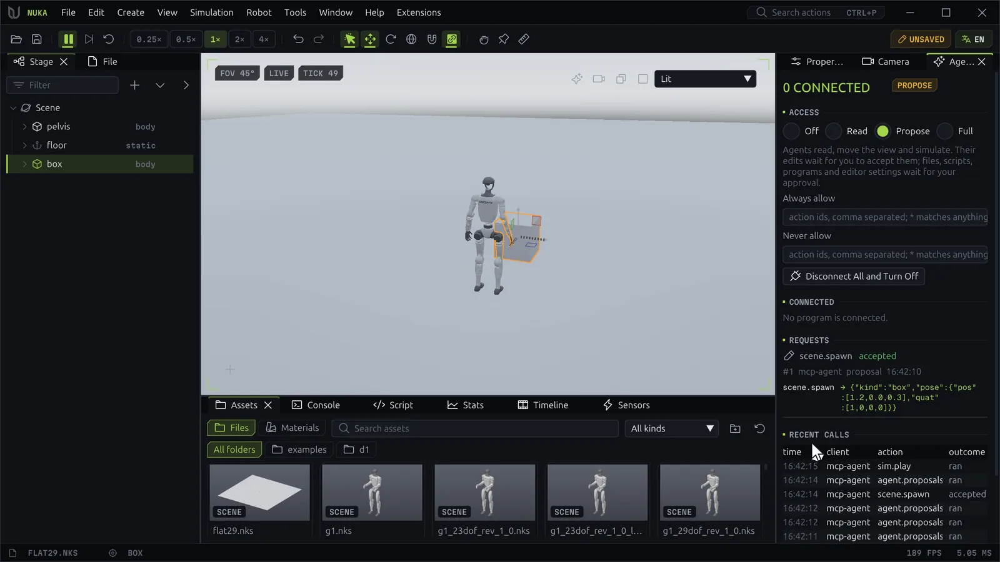

# Agents and MCP



AI agents and other programs drive the editor through the same [actions](../reference/actions/index.md)
as its menus and panels. An MCP server connects any MCP client (Claude Code, desktop apps, IDEs) to an
editor running on the same machine. You decide what they may do, and see every call they make.

## Connecting an MCP client

The server ships with the `nuka` Python package and with the packaged app. It speaks MCP over stdio.

| Installed as | Command |
| --- | --- |
| Python package | `nuka-mcp`, or `python -m nuka.mcp` |
| Packaged app | `<app folder>\nuka-editor.exe --mcp` |

`--profile DIR` picks the editor profile and `--pid PID` one editor of several (or the environment
variables `NUKA_EDITOR_PROFILE` and `NUKA_EDITOR_PID`).

=== "Claude Code"

    ```console
    claude mcp add nuka-editor -- nuka-mcp
    ```

=== ".mcp.json"

    ```json
    {"mcpServers": {"nuka-editor": {"command": "nuka-mcp", "args": []}}}
    ```

=== "Packaged app"

    ```json
    {"mcpServers": {"nuka-editor": {
      "command": "C:/Tools/Nuka Editor/nuka-editor.exe", "args": ["--mcp"]}}}
    ```

Other clients take the same command and arguments in their stdio server settings.

### The skill

The `nuka-editor` skill teaches an agent how to work the editor: connecting, finding actions, common
workflows, access and undo, and checking its work.

```console
python -m nuka.mcp install-skill                 # into ~/.claude/skills/nuka-editor
python -m nuka.mcp install-skill --dest DIR      # another agent's skills folder
```

## The tools

| Tool | Does |
| --- | --- |
| `editor_status` | Lists the running editors and connects to the newest; shows its document and agent access |
| `editor_launch` | Starts an editor window, optionally on a scene, and connects to it |
| `actions_find` | Searches the actions by words, category or kind |
| `action_help` | One action's description, arguments, return value, example and kind |
| `action_run` | Runs one action and returns its value |
| `actions_batch` | Runs several actions in order, stopping at the first failure unless told not to |
| `wait_for` | Repeats a read action until its value matches, for example `train.status` until `{alive: false}` |
| `document_get` | The document's path, revision, dirty flag, hash, undo depth, tick, selection, playing |
| `scene_tree` | The scene's nodes with their world poses, filtered by path, kind and depth |
| `screenshot` | A picture of the editor window or of its viewport |
| `console_read` | The console's text since an offset |
| `action_log` | Every action run so far, by anyone |
| `python_eval` | Runs Python in the editor's console and returns its output |
| `edit_propose` | Offers an edit for you to review before it applies |
| `proposal_get` | The state of a request waiting for you |
| `scenario_run` | Runs a list of actions, waits, expectations and screenshots and reports each |

The server also offers resources: `nuka://catalog` (every action), `nuka://document` and the skill's
guides as `nuka://guide/<page>`.

## Access modes

The **Agents** panel (**Window → Agents**) sets what agents may do. Every action has a
[kind](../reference/actions/index.md#kinds), and the mode decides per kind:

| Kind | Full | Propose | Read |
| --- | --- | --- | --- |
| read, view | runs | runs | runs |
| sim | runs | runs | refused |
| edit | runs | becomes a proposal | refused |
| file, process, app | runs | waits for approval | refused |

**Off** lets no program reach the editor. The editor starts in **Full** unless you chose otherwise; the
choice is kept in the profile.

- **Always allow** runs listed actions without asking, **Never allow** refuses them in every mode. Both
  take action ids, comma separated, with `*` as a wildcard (`file.*`); press ++enter++ to apply.
- **Disconnect All and Turn Off** drops every agent and sets the mode to Off.
- Changing the mode, answering requests and disconnecting are yours alone; an agent can't widen its own
  access.

## Proposals and approvals

In **Propose** mode:

- An **edit** becomes a proposal. The panel's **Requests** list shows each field's value before and
  after, with the agent's note. **Accept** applies it as one undoable step named `Agent: <label>`;
  **Reject** refuses it.
- A **file, process or app** action waits for approval. A dialog asks: "*client* asks to run *action*",
  with its arguments. **Allow Once** runs it, **Always Allow** also adds it to the allow list, **Deny**
  refuses it.

An agent can also offer an edit for review in any mode but Read, with `edit_propose`.

## Watching agents

- The status bar shows **AGENT N** while N programs are connected, and **N WAITING** while requests
  wait for you.
- **Connected** lists each client with its process id, since when and how many calls it made.
- **Recent Calls** lists each call with its time, client, action and outcome.
- Every agent call also goes into the action log (source `agent:<client>`) and into the profile's audit
  file `logs/agent-<date>.jsonl`, with its arguments, outcome and time.

Every edit, an agent's or yours, is a step in the one undo history.

## Without MCP

Python programs on the same machine connect directly:

```python
from nuka.editor import connect

with connect(client="my-tool") as editor:
    editor.actions.run("file.new", template="ground", discard=True)
    editor.actions.run("scene.add_box")
    print(editor.document()["revision"])
    shot = editor.screenshot()          # the next frame as a PPM: its path and the viewport's rectangle
```

`editor.actions.run/list/log`, `document()`, `console()`, `screenshot()` and `wait()` match the MCP
tools; [Python: the editor](../python/editor.md) has the rest.
