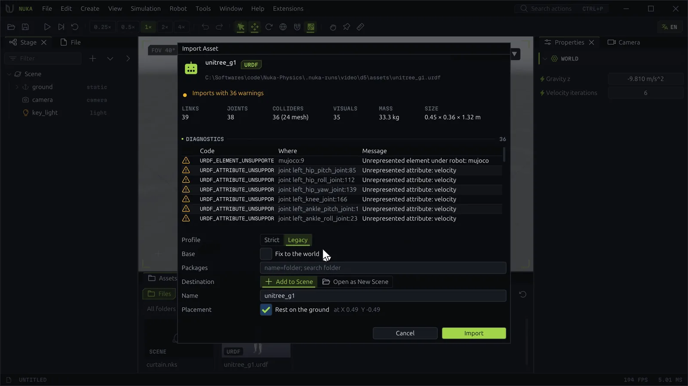

# Importing assets

The editor imports robots and environments from the usual formats and brings their materials and
textures along:

| Format | Extensions | Typical content |
| --- | --- | --- |
| URDF | `.urdf` | Robots: links, joints, limits, inertia, meshes, colors and textures |
| MJCF | `.xml` | MuJoCo robots and scenes |
| OpenUSD | `.usd`, `.usda`, `.usdc`, `.usdz` | Robots with UsdPhysics, and whole environments with materials and lights |
| Meshes | `.obj`, `.stl`, `.glb` | A single body or a static prop |
| Nuka scene | `.nks` | Another scene, added under a node |

## Starting an import

- **File → Import Asset...** (++ctrl+i++), or **Create → Import Asset...**
- Drag a card from the **Assets** panel onto the viewport, or right-click it for **Import...**, **Add to
  Scene** or **Open as New Scene**.
- Drop a file from the file browser onto the editor window.
- **Import** on the start page imports into a new document.

## The import wizard

The wizard reads the file before anything changes and shows:

- **The verdict**: *Imports cleanly*, *Imports with N warnings*, or *Does not import: N errors*.
- **Links, joints, colliders** (and how many are meshes), **visuals, mass and size**, so you can tell at a
  glance whether the robot came in whole.
- **Diagnostics**: each problem with its code, where it is (element and line) and a message. Warnings name
  what the import drops or changes; errors name what stops it.

Then it takes the options:

| Option | Meaning |
| --- | --- |
| **Profile** (URDF) | **Strict** rejects deprecated and ambiguous forms; **Legacy** accepts the forms older exporters write. When Strict refuses a file, **Retry with Legacy** switches. See [URDF import profiles](../import/urdf_profiles.md). |
| **Base** | **Fix to the world** bolts the robot's root to the world, for arms on a table. |
| **Packages** (URDF) | Where `package://` mesh paths look: `name=folder` entries or search folders, separated by `;`. ++enter++ checks again. |
| **Colliders** (URDF, MJCF) | **Convex Hulls** (the default) turns each triangle-mesh collider on a moving link into the convex hull of its mesh, as MuJoCo collides mesh geoms; **Triangle Meshes** keeps the meshes, with a `MESH_COLLIDERS` warning, since contact against them runs far slower. A mesh that names its own decomposition, SDF contact or reduction is kept either way. |
| **Lights** (USD) | How the stage's light intensities read: **Isaac** (Isaac Sim's units, a 3000 sun is 3), **Nits** (the schema's nits) or **Raw** (as written). |
| **Destination** | **Add to Scene** adds it to the open document as one undoable step; **Open as New Scene** makes it a document of its own. |
| **Name** | The new node's name; the file's name by default. |
| **Placement** | **Rest on the ground** lowers it until its lowest shape touches z = 0, at the point shown, unless the asset brings its own floor. |

**Import** runs it. The new node is selected, and the robot or environment appears where the placement
said.

USD and NKS scene containers preserve their authored coordinates by default, including when dragged
into the viewport. **Rest on the ground** starts unchecked for these formats; enable it explicitly when
needed. Robots imported from URDF or MJCF and individual mesh objects keep ground placement enabled.

!!! tip "Analyze without importing"
    `file.import_analyze {path}` returns the same verdict, statistics and diagnostics as the wizard,
    without changing anything; scripts and agents use it to check a file first.

## What comes in

- **Robots** become articulations: links as bodies, joints with their limits, drives, damping and
  armature, inertia from the file, collision shapes from collision elements (or meshes), and visual
  meshes with their materials.
- **Environments** keep their hierarchy as groups and static bodies. Many environment files carry visual
  meshes only; [generate colliders](scene.md#generating-colliders) for them afterwards.
- **Materials**: colors, PBR values and texture maps (base color, roughness, metallic, normal, emissive)
  come in as editor materials, one per material in the file. USD `UsdPreviewSurface` and Omniverse
  `OmniPBR` materials are both read. Each part keeps its own material, which you can change afterwards;
  see [Materials](materials.md).
- **Lights and cameras** of USD stages come in as scene lights and cameras.

## Sources and reimport

Selecting an imported node shows a **Source** section at the top of **Properties**: the file, its format
and the options the import used, with **Reimport** and **Show in Folder**.

**Reimport** reads the file again and replaces the node where its root stands now. Edits made inside the
node are lost, as the confirmation says; **Undo** brings them back. Use it after changing the URDF or USD
outside the editor. `asset.sources` lists every import of the document and whether its file still
exists.

## The Assets panel

The **Assets** panel lists importable files as cards with thumbnails, from:

- the examples that ship with the editor,
- the open document's folder,
- folders you add with the folder button (**Add Asset Folder...**), kept in your profile.

Filter by name with the search box, by kind (scenes, URDF, MJCF, USD, meshes) and by folder. **Rescan**
picks up new files. The **Materials** page of the same panel lists the scene's materials; see
[Materials](materials.md).

## Exporting USD

**File → Export USD...** writes the scene, or with `node` one Stage node and everything under it, as a
UsdPhysics stage: bodies, joints with drives and limits, colliders, masses, terrain, materials, lights
and cameras, with meshes shared between their uses. The
file's extension picks the format (`.usd`, `.usda`, `.usdc`, `.usdz`). **Lights** chooses the units, as on
import. Whatever USD cannot carry is listed as warnings in the Console and in the action's result.
