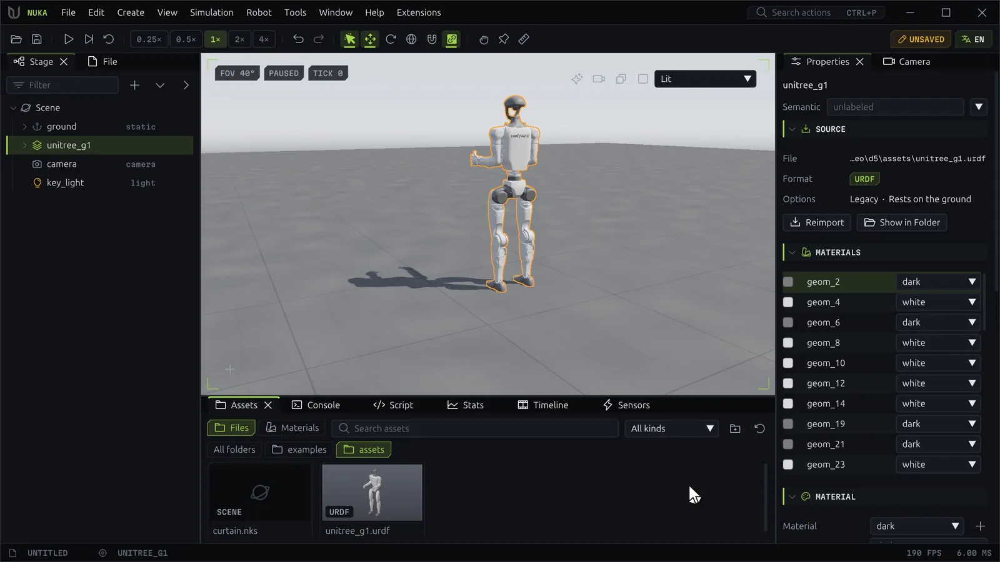

# The editor

The Nuka editor is where a scene is built, simulated and inspected. It drives the same GPU world that
Python scripts and training runs use, so what you see in the viewport is the engine's state, not a
preview of it.

## The window

From top to bottom:

The title bar
:   The Nuka mark, the menus (**File, Edit, Create, View, Simulation, Robot, Tools, Window, Help,
    Extensions**), the **Search actions** box (++ctrl+p++) and the window buttons. Drag the empty part of
    the bar to move the window; double-click it to maximize.

The toolbar
:   Common commands, left to right:

    | Group | Buttons |
    | --- | --- |
    | Files | Open (++ctrl+o++), Save (++ctrl+s++) |
    | Transport | Play/Pause (++space++), Step, Reset |
    | Speed | 0.25×, 0.5×, 1×, 2×, 4× |
    | History | Undo (++ctrl+z++), Redo (++ctrl+y++) |
    | Gizmo | Gizmo on/off, Move, Rotate, World/Local space, Snap (right-click sets the step), IK Drag |
    | Tools | Perturb (right-click sets the stiffness), Pin, Measure (right-click picks origin or center of mass) |

    On the right, status chips report what needs attention: **UNSAVED** while the document has unsaved
    changes, **SOLVER CAP ×N** when recent solves spent their sweep budget above the alert residual
    (click it to locate the worst element), **CAP ×N** when the physics fell behind real time,
    **SCRIPT** or **SCRIPT DRIVEN** while a Python host runs the editor, and the language switch
    (**EN** / **中**, ++ctrl+shift+l++).

The workspace
:   Docked panels around the **viewport**. The viewport's corner chips show the field of view, the state
    (**PAUSED**, **LIVE**, **OBSERVING** a training run, **SCRIPT DRIVEN**) and the tick. Its top-right
    buttons are RT Preview, Render This View, Environments and View Layout, followed by the view-mode
    menu (Lit, Unlit, Normals, Material ID, Residual, Contact, Wireframe).

The status bar
:   The document's name, the selected node's path, the environment shown when there are several, and the
    frame rate and frame time. **IK MISS** appears while an IK drag falls short of the gizmo, and
    **AGENT N** while external programs are connected.

## Panels

Every panel opens from the **Window** menu or with `window.focus {panel}`, and docks anywhere: drag its
tab to another column or out of the window.

| Panel | What it is for |
| --- | --- |
| **Stage** | The scene tree: select, rename, reparent, hide, lock and spawn. See [Building scenes](scene.md). |
| **Properties** | Transform, material, body, joint, collision and world fields of the selection. |
| **File** | Open, save and load scenes. |
| **Assets** | Importable files and the scene's materials, to drop into the scene or open. |
| **Camera** | The camera's pose, field of view and the navigation keys. |
| **Stats** | Frame and physics timings, model size, render counts. |
| **Debug** | Collider and contact overlays. See [Inspecting physics](inspect.md). |
| **Solver** | Time step, sweep budget, residuals, alerts and the residual heatmap. |
| **Timeline** | Seek, replay and fork the run, compare branches with a ghost, export video. |
| **Joints** | Joint states, drive targets and gains, the fixed base and teleop. See [Robots](robots.md). |
| **Poses** | Named joint poses to blend to, start from, import and export. |
| **Policy** | Load a locomotion policy, run or stop it and watch its actions. |
| **Demos** | Record teleoperated demonstrations, replay them and save them as HDF5. |
| **Sensors** | Preview each sensor's images, ranges and readings as the simulation runs. |
| **Randomize** | Randomize looks, masses, gravity and parameters from a seed, again on reset. |
| **Training** | Configure a task, start and watch runs, plot them and play their saves. |
| **Script** | The Python editor. See [Scripting](scripting.md). |
| **Console** | Script output and a Python prompt. |
| **Agents** | The programs driving the editor from outside, their access, requests and calls. |
| **UI Inspector** | The component tree of every panel, for extension authors. |

Some tools open as windows of their own: the Import wizard, Generate Collision, Terrain, the Gain Tuner,
System Identification, the Robot Assembler, the Clip Editor and Export Dataset.

## Layouts

**Window → Authoring / Debug / Robot / Data / Training Layout** arranges the panels for a kind of work:

| Layout | Left | Right | Bottom |
| --- | --- | --- | --- |
| Authoring | Stage, File | Properties, Camera | Assets, Console, Script, Stats, Timeline, Sensors |
| Debug | Stage | Solver, Debug, Stats, Properties | Console, Timeline, Script, Assets |
| Robot | Stage | Joints, Poses, Policy, Demos, Properties | Console, Timeline, Stats, Assets, Sensors |
| Data | File, Stage | Sensors, Randomize, Stats, Camera, Properties | Assets, Console, Script, Timeline |
| Training | Stats, Stage | Training, Policy, Camera | Console, Script, Assets, Timeline |

**Window → Reset Layout** puts the panels of the current layout back. `--layout robot` on the command
line starts in a layout.

## The command palette

++ctrl+p++ (or ++ctrl+shift+p++, or the **Search actions** box) opens the command palette. Type part of
a command's name; the palette matches its letters in order, ranks word starts first, and runs the
highlighted action with ++enter++.
++esc++ closes it. It lists every action, including those extensions add, with its shortcut.

## Undo

Every change to the document, from a panel, the gizmo, a script or an agent, is one step in a single
history: ++ctrl+z++ undoes it and ++ctrl+y++ (or ++ctrl+shift+z++) redoes it. Simulating does not
change the document, so it is not in the history; reset the simulation with **Reset**. Clips keep a
history of their own inside the Clip Editor.

## Language and scale

- **View → Switch Language** (++ctrl+shift+l++) steps through the UI languages; English and Simplified
  Chinese ship with the editor.
- ++ctrl+equal++ and ++ctrl+minus++ make the UI larger or smaller, ++ctrl+0++ resets it. `--ui-scale`
  sets it at start.

## Live and rebuild fields

The editor changes a running world in two ways:

- **Live** fields (⚡ in Properties: masses, gains, friction, gravity, iterations and many more) apply at
  the next physics step, while the simulation plays.
- **Rebuild** fields (structure, shapes, joint types) need the world cooked again. Properties gathers
  such edits as *pending*; **Apply & Rebuild** applies them together, carrying the bodies' and joints'
  state over to the new world.

The [Building scenes](scene.md#the-properties-panel) page has the details.
