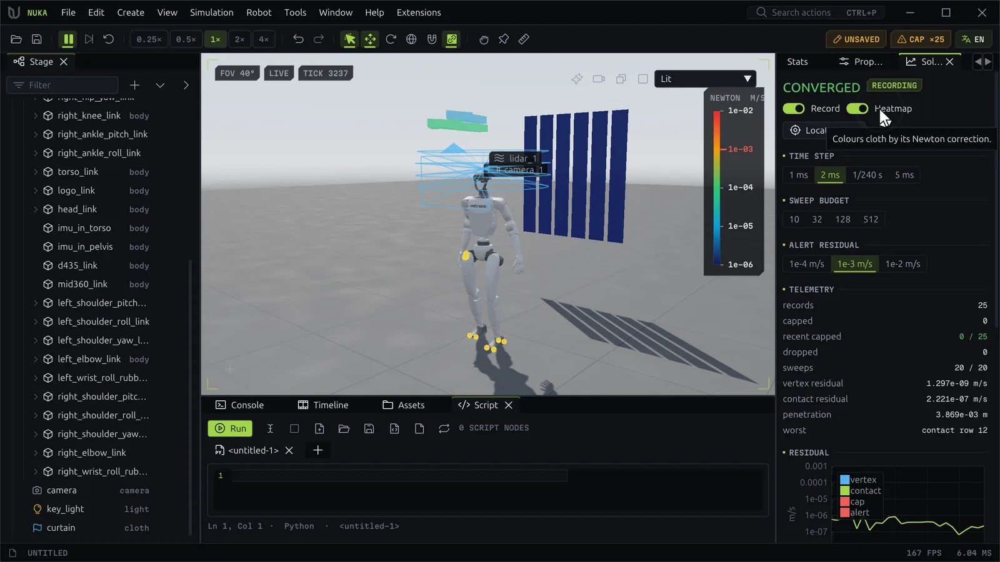

# Inspecting physics



The **Debug** layout puts the inspection panels on the right: Solver, Debug, Stats and Properties, with
the Timeline at the bottom.

## The Debug panel

The Debug panel only shows; it changes nothing.

- **Collider proxies** draws every collider as a see-through wireframe: green for dynamic colliders,
  magenta for static ones.
- **Contact points** marks each contact in orange. Markers show where contacts are, not their forces.
- **Hide all** turns the overlays off.

Under **Last overlay** it counts the proxies and markers drawn, and warns when shapes were skipped,
data was invalid or the overlay's budget was full. **N/A** means disabled, unavailable or not read.
The same switches are in the **View** menu and on the command line (`--show-colliders`,
`--show-contacts`).

## The Solver panel

The Solver panel records what each solve did and finds where it struggled.

The header says **OFF** (not recording), **CONVERGED**, or **CAP ×N** when N recent solves spent their
whole sweep budget above the alert residual. The toolbar's **SOLVER CAP ×N** chip says the same while
you work in other panels; click it to locate the worst element.

| Control | Does |
| --- | --- |
| **Record** | Records each solve's residual, sweeps and energy |
| **Heatmap** | Colors cloth by its Newton correction, on a log scale shown at the viewport's right edge |
| **Locate worst** | Frames and marks the worst element of the newest capped solve, or of the newest solve |
| **Time step** | 1 ms, 2 ms, 1/240 s or 5 ms; rebuilds the world and keeps its state |
| **Sweep budget** | 10, 32, 128 or 512 velocity sweeps per substep; the solve stops early at its tolerance |
| **Alert residual** | 1e-4, 1e-3 or 1e-2 m/s: a solve that spends its budget above it counts as capped |

**Telemetry** lists the records kept, the capped solves (all and recent), records dropped, and the
newest solve's sweeps, vertex residual, contact residual, deepest penetration and worst element.

The plots, once recording:

- **Residual**: vertex and contact residuals per solve, capped solves as red diamonds, and the alert line;
- **sweeps** per solve against the budget;
- **Convergence**: the newest solve's residual sweep by sweep (a capped one when any is kept);
- **Energy**: the total energy and the energy ledger's residual.

**Capped solves** lists the last 8 capped solves with their sweeps, residual and worst element; the
target button locates one. The located element gets a pulsing red reticle with its name and residual.

```python
app.actions.run("solver.telemetry", alert=1e-3)   # no mask: every channel, toggled on
app.actions.run("sim.step", steps=240)
caps = app.actions.run("solver.records", capped=True)
app.actions.run("solver.locate")
```

The viewport's **Residual** view mode shows the same per-vertex residual on cloth and soft bodies
([Viewport and camera](viewport.md)).

## The timeline

The **Timeline** panel keeps the simulation's history, so you can go back, look and try again.

The header shows the playhead tick and the head (the newest tick), **LIVE** at the head or **REPLAY**
behind it, and **EXACT** or **APPROX**:

- **Exact**: replay repeats the recording bit for bit.
- **Approx**: a controller or script ran, and replay snaps back to each keyframe.

**Scrubber**
:   Drag to seek; the world replays to the tick under the pointer. Small ticks mark keyframes, amber
    diamonds keyframes holding writes the input log can't replay, and triangles where branches fork.

**Transport**
:   To start, back one tick, forward one tick, to the head. **Fork** starts a new branch at the playhead.
    **Ghost** draws another branch's bodies over this one at the same tick.

**Save, load, export**
:   Save the current branch as a `.nkrec` recording, load one back (for the same document and world
    layout), or **Export an MP4 video** of the history, drawn by the viewport and encoded by ffmpeg from
    the PATH.

**Branches**
:   Every branch with its fork tick, head and whether it replays exactly. Click one to switch to it;
    right-click to rename it; the ghost button shows it as the ghost.

**Keyframes**
:   How many are kept and the memory they use, the interval (every 4, 16 or 64 ticks: fewer seek
    faster, more keep a longer history) and the budget (256 MB, 1 GB or 4 GB; past it the oldest detail
    thins out first). **Clear history** drops the history and branches and keeps the world where it is.

Behind the head the world replays the recorded history. An input there (a push, a new target, an edit)
starts a new branch from that tick, so the old history stays.

```python
app.actions.run("timeline.seek", delta=-120)    # 120 physics steps back
app.actions.run("timeline.fork", label="push harder")
app.actions.run("sim.perturb", path="/World/g1/pelvis", force=[0, 150, 0])
app.actions.run("timeline.ghost", on=True)
```

Python reads `.nkrec` recordings with `nuka.editor.nkrec` ([File formats](../reference/file-formats.md#recordings)).

## Streaming to Rerun

**Simulation → Stream to Rerun** (`rerun.stream`) logs the shown environment's link and body poses to
[Rerun](https://rerun.io) at the head, over the `tick` and `sim_time` timelines: to a new local viewer,
to a running one at `addr`, or into an `.rrd` file. It needs `rerun-sdk` in the editor's Python.

```python
app.actions.run("rerun.stream", on=True, file="C:/runs/walk.rrd", every=2)
```

## The Stats panel

| Section | Shows |
| --- | --- |
| Header | The physics step time (amber when it falls behind) and a sparkline of it |
| **Timing** | Frames per second, frame time with a sparkline, sub-steps per frame, ticks, snapshot age, dropped snapshots, capped batches (frames where the physics fell behind real time, the toolbar's **CAP ×N**), and **HOST COPY** with its reason when publishing falls back from zero-copy |
| **Model** | Degrees of freedom, links, bodies, the contact cap and the shown environment |
| **Render** | Draw calls, instances, lit pixels and the GPU |
