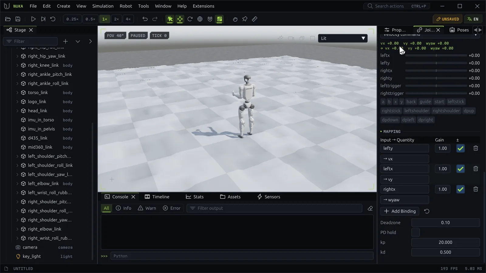
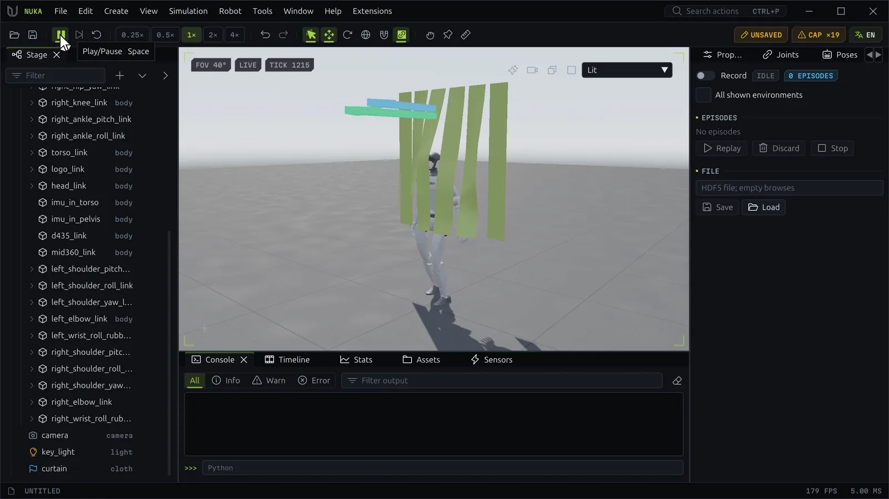

# Teleop, policies, demos and clips

Four ways to make a robot move, all writing its drive targets: drive it live (teleop), let a trained
policy drive it, replay a recorded demonstration, or play a keyframed clip.

## Teleop



The **Teleop** section of the Joints panel reads a device and maps it through a mode.

**Enabled**
:   Turns teleop on. The badge says **driving**, **idle** or **disconnected**.

**Device**
:   **Keyboard**, the **Virtual device** (set by scripts and agents), each plugged-in gamepad, and
    devices from extensions. All report the same gamepad layout: axes `leftx`, `lefty`, `rightx`,
    `righty`, `lefttrigger`, `righttrigger` and buttons `a`, `b`, `x`, `y`, `back`, `guide`, `start`,
    `leftstick`, `rightstick`, `leftshoulder`, `rightshoulder`, `dpup`, `dpdown`, `dpleft`, `dpright`.
    The panel shows the device's axes as bars and its buttons as chips lit while held.

**Mode**
:   What the device drives:

    | Mode | Quantities | Default mapping |
    | --- | --- | --- |
    | **Velocity command** | `vx`, `vy` (m/s), `wyaw` (rad/s) for a loaded policy | left stick forward/left, right stick yaw |
    | **Joint rate** | `rate` of one **Joint**, `next` and `prev` to change joint | left stick, shoulders |
    | **IK goal** | `x`, `y`, `z` world velocity of a **Link**'s goal (the selected one by default) | left stick, right stick up/down, gain 0.2 |

    Extensions add their own modes.

With the keyboard, ++w++ ++s++ and ++a++ ++d++ are the left stick, ++q++ ++e++ the right stick across
and ++page-up++ / ++page-down++ along it; ++minus++ and ++equal++ are the shoulders. While the keyboard
drives, these keys don't fly the camera. ++ctrl++ chords stay shortcuts.

**Mapping**
:   Each binding scales one input into a quantity: pick the **Input** and the **Quantity**, the **Gain**
    and **±** to invert. **Add Binding** adds one; the reset button restores the mode's defaults.
    Several bindings of one quantity add up.

**Deadzone**
:   How far an axis moves before it counts, shared by every axis.

**PD hold**
:   Holds the robot's pose with a PD law of the **kp** and **kd** below, for joints without a position
    drive.

In the velocity command mode, a robot without a policy doesn't move; the panel says so.

From a script or an agent, the virtual device takes the place of hardware:

```python
app.actions.run("teleop.use", on=True, device="virtual", mode="command")
app.actions.run("teleop.input", axes={"lefty": -0.6})   # stick forward: vx > 0
```

`teleop.pad` attaches a virtual gamepad on SDL's joystick path instead, for testing pad handling.

## Policies



The **Policy** panel runs a trained locomotion policy on the scene's robots.

1. Type a path in **Policy file**, or leave it empty to browse, and press **Load**. **Host MLP** runs the
   network on the CPU instead of the GPU.
2. **Run** starts and stops it; stopped, the drive targets hold where it left them.
3. **Arrows** draws the commanded velocity and the measured velocity over each robot.
4. Steer it with teleop's velocity command mode.

The panel shows the robots it drives, its observation and action sizes, how often it decides (Hz and
physics steps per decision), the command it reads and a plot of its action norm.

Policies are **NKML** files (`.nkml`, or the older `.bin`). A training run writes a
`<name>.contract.json` beside each checkpoint: its joints, observation terms and gains. A policy with a
contract runs on every robot that has the contract's joints; one without runs under the Go2 contract.
A policy runs at the physics step it was trained at; see [Simulation](simulation.md#time-step).

**Unload** detaches it. Training's **Play Best** and **Play Latest** load a run's checkpoint in one click
([Training](training.md#checkpoints)).

## Demonstrations

The **Demos** panel records what drives the robot and replays it.

- **Record** starts and stops recording. Each step records the joints, the drive targets, the base, the
  command and the device's axes; the badge counts the samples. **All shown environments** records each
  displayed environment as its own episode.
- **Episodes** lists each recording's environment, steps and seconds. Double-click one, or select it and
  press **Replay**, to drive the targets from it. A replay starts from the state now: reset first to
  replay from its start. **Stop** ends it; **Discard** drops the episode.
- **File** saves the episodes to an HDF5 file in robomimic's layout, or loads them back, matching joints
  by name ([File formats](../reference/file-formats.md#demonstrations)).

Demonstrations also feed [system identification](robots.md#system-identification).

## Clips

The **Clip Editor** (**Robot → Clip Editor**) keys the robot's joint targets over time. Clips are saved
beside the document.

**Top bar**
:   The clip being edited (right-click it to rename or remove it), **New**, **Duration**, **Loop**,
    **Play** / **Stop**, undo and redo of clip edits, **Export Clip...** and **Import Clip...**
    (`.nkclip.json`).

**Keying**
:   **Key Pose** keys every joint at the playhead where the robot stands now; the combo beside it keys
    a saved pose instead. With **Auto-key** on, moving a joint target or dragging IK keys it at the
    playhead. **Step**, **Linear** or **Bezier** is the interpolation new keys take.

**Dope sheet**
:   A **Summary** row, then a row per joint. Press or drag the ruler to move the playhead; releasing it
    sets the robot's targets to the clip's values there. Click a key to select it (++ctrl++ or
    ++shift++ adds), drag to move keys in time, drag on empty space to box-select. Double-click a joint's
    row to key it there. Click a joint's name to show its curve. Right-click for the selection's
    interpolation, **Copy**, **Paste** (at the playhead) and **Delete**. Keys snap to the physics step.

**Curve editor**
:   The chosen joint's curve, with the other keyed joints faint behind it. Drag a key to change its time
    and value; a Bezier key shows two handles for its slopes. Drag the playhead line to scrub.

| Key | In the Clip Editor |
| --- | --- |
| ++delete++ | Delete the selected keys |
| ++ctrl+c++ / ++ctrl+v++ | Copy the selected keys; paste them at the playhead |
| ++ctrl+a++ | Select every key |
| ++ctrl+z++, ++ctrl+y++ or ++ctrl+shift+z++ | Undo, redo a clip edit; scene edits keep their own history |

A key's mark shows its interpolation: a square for step, a diamond for linear and a circle for Bezier.

`clip.play` drives the shown environment through a clip, looping if asked. From a script:

```python
app.actions.run("clip.new", name="wave", duration=2.0, loop=True)
app.actions.run("clip.key", keys=[
    {"joint": "right_shoulder_roll_joint", "time": 0.0, "value": -0.2},
    {"joint": "right_shoulder_roll_joint", "time": 1.0, "value": -1.4, "interp": "bezier"},
    {"joint": "right_shoulder_roll_joint", "time": 2.0, "value": -0.2},
])
app.actions.run("clip.play", clip="wave")
```
