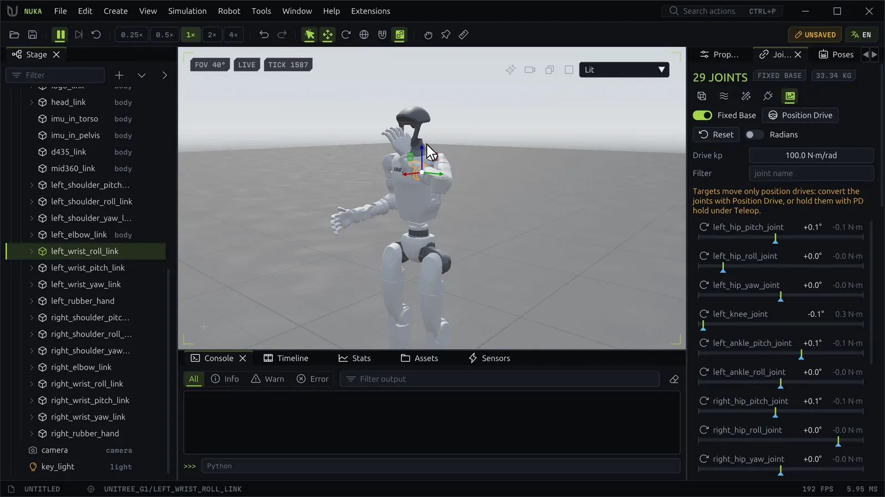

# Robots



An imported URDF, MJCF or USD articulation is a **robot**: links joined by joints, under one root. The
**Robot** layout puts the robot panels on the right: Joints, Poses, Policy, Demos and Properties. The
**Robot** menu holds the same commands: Fixed Base, Position Drive, Reset targets, Radians, Watch Joints,
Gain Tuner, System Identification, Robot Assembler, Clip Editor, and capturing, saving and loading
poses.

## The Joints panel

The header counts the moving joints and shows whether the base floats and the robot's total mass. Its
buttons toggle the robot overlays, open the Gain Tuner, System Identification and the Robot Assembler,
and turn the joint watch on or off.

| Control | Does |
| --- | --- |
| **Fixed Base** | Makes every robot root static (bolted to the world) or free again; one undoable edit |
| **Position Drive** | Gives every joint a position drive with the **Drive kp** below; one undoable edit |
| **Reset** | Puts every drive target back at the joint's initial position |
| **Radians** | Shows revolute joints in radians instead of degrees |
| **Drive kp** | The stiffness Position Drive gives, in N·m/rad |
| **Filter** | Shows only joints whose name contains the text |

Each joint has a row: its name, its value and its effort (amber while the actuator saturates) over a
bar from the lower to the upper limit. The fill is the value, the caret below it is the drive target,
and the value turns amber within 2% of a limit. **Drag along the bar** to set the target. Click the row
to select the joint's link; hover it for the drive, the force limit and the velocity.

Targets move only joints with a **position drive**. When some joints have another drive the panel says
so: convert them with Position Drive, or hold them with **PD hold** under [Teleop](motion.md#teleop).

### Joint curves

Selecting a joint plots its target, its actual value and its effort over the last 5 simulated seconds,
below the rows. Selecting starts the joint watch, which samples every step while it is on; play or step
the simulation to fill the plot. `robot.samples` returns the same samples.

### Drives

A joint's drive is one of **position**, **motor**, **velocity** or **force**; **Position Drive** and
`robot.drive` set it. Selecting a link shows its joint and drive in Properties: the **Joint** section has
damping, stiffness, armature, friction loss and the limits, the **Drive** section the gain and the force
limit. The Gain Tuner edits the same fields (`actuator.gain`, `joint.damping`,
`actuator.force_limit`).

## Poses

The **Poses** panel keeps named joint poses with the document.

- **+** (Capture Pose) keeps the shown environment's joint positions as a new pose.
- **Click a pose** to blend the drive targets to it over the **Blend time** (seconds of simulated time).
- Its context menu: **Apply Instantly**, **Set as Initial** (the robot starts there after a reset; one
  undoable edit), **Copy as JSON**, **Rename** and **Remove**.
- **Robot → Save Poses / Load Poses** writes and reads them as a JSON file
  (see [File formats](../reference/file-formats.md#poses)).

A pose holds only the joints it names; applying it leaves the other joints' targets alone.

## Inverse kinematics

**IK Drag** on the toolbar turns the gizmo into an IK handle. Select a link below the root (a hand, a
foot) and drag the gizmo:

- **Move** takes the link's origin with the gizmo, and the joints of its chain follow.
- **Rotate** turns the link about where it is.

The solution is written to the drive targets, so the robot follows through its position drives. With a
floating base it may fall: turn **Fixed Base** on while posing.

The **IK** section of the Joints panel sets how a drag solves:

| Setting | Does |
| --- | --- |
| **Gizmo drag** | The same switch as IK Drag |
| **Lock orientation** | A move also tries to keep the link's orientation |
| **Rotation weight** | How much orientation error counts against position error, in m/rad |
| **Chain root** | Where the chain starts: the articulation's root, or any link |
| **Pinned links** | Links a drag holds where they are; **Pin Selected** adds the selected link |

With no pins a drag moves the whole chain. When the solve ends more than 1 mm or 0.5° from the gizmo,
the status bar shows **IK MISS** with the distance and the angle left.

`robot.ik` solves the same problem from a script, with or without applying it:

```python
r = app.actions.run("robot.ik", link="/World/g1/left_wrist_yaw_link", pos=[0.35, 0.2, 1.0],
                    position_only=True, apply=False)
print(r["position_error"], r["q"])
```

## Robot overlays

**View → Robot Overlays** (or the overlays button in the Joints panel) draws, over the viewport:

| Overlay | Shows |
| --- | --- |
| **Link Frames** | Each link's frame |
| **Joint Axes** | Each joint's axis with its limits, the value and the target caret |
| **Center of Mass** | Each link's COM, and the robot's COM with its drop to the ground and total mass |
| **Inertia Boxes** | The box of each link's inertia, when its principal moments allow one |
| **Translucent Meshes** | See-through links, so the overlays show through |

Hovering a link shows its mass and the joint it hangs from with the joint's value.

The toolbar's **Measure** tool measures between links, joint origins and the ground
([Simulation](simulation.md#pushing-things-around)); `robot.links` lists each link's mass, origin and
COM, and the robot's total mass, COM and degrees of freedom.

## Gain Tuner

The **Gain Tuner** tests one joint's response in a copy of the world that it throws away afterwards.

1. Pick the **Joint**, a **Step test** or a **Sine test**, the **Amplitude**, the sine's **Frequency**
   and the **Duration** (up to 10 s).
2. Adjust **kp**, **Damping** and **Force limit**. Each drag is one undoable edit to the document.
3. Press **Run**. The joint needs a position drive, and a floating robot falls during the test; the
   window offers **Position Drive** and **Fixed Base** buttons when needed.

The plot overlays the last 6 runs, each labeled with its kp. The table gives each run's rise time,
overshoot, settling time, steady error, damping ratio ζ and natural frequency ωn; for a sine, the gain
in dB, the lag and the RMSE; and the share of steps the actuator saturated. **Clear** forgets the runs.

## System identification

**System Identification** fits joint damping, armature, friction loss or a link mass scale to a
recorded demonstration ([Demonstrations](motion.md#demonstrations)).

1. Record or load an episode in the Demos panel.
2. Pick the **Episode**, the **Generations** (default 20) and the **Population** (default 8).
3. Add a row per **Parameter**: which quantity, for **All joints** or one, and its **Min** and **Max**.
4. Press **Identify**. CMA-ES replays the episode's drive targets from its first step for each
   candidate and scores the mean squared joint error against what was recorded. The world is put back
   after each replay.
5. The **Fit** section shows the error before and after, the best loss per generation and each
   quantity's value before and identified. **Apply** writes the result in one undoable edit; it is
   available only when the fit improved.

**Stop** ends a search early with the best values found so far.

## Robot Assembler

The **Robot Assembler** hangs one thing off a robot link through a new joint.

**Asset file**
:   Browse to a URDF, MJCF or USD file and pick its **Mount** link (its root by default). It comes in
    with the import options; the **Position** and **Rotation** place the mount in the parent link's
    frame. Only a fixed joint can mount a link other than the root.

**Scene body**
:   Pick a body already in the scene (**Use Selection** takes the selected one). **Keep where it is**
    leaves it in place; **Offset** places it in the parent link's frame.

Then pick the **Parent link** and the **Joint** (fixed, revolute or prismatic, with an **Axis**) and
press **Attach**. Opening the Assembler with a link selected makes that link the parent.

```python
app.actions.run("robot.attach_asset", path="C:/assets/gripper/gripper.urdf",
                parent="/World/go2/base", frame={"pos": [0.2, 0, 0.1]})
```
