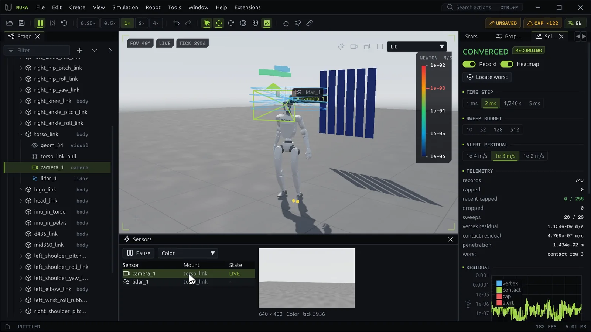

# Sensors and datasets



## Sensor types

| Type | Id | Reads |
| --- | --- | --- |
| **Camera** | `camera` | Color, depth, normal, albedo and instance images |
| **Depth Camera** | `depth` | A camera that keeps only depth |
| **Lidar** | `lidar` | Ranges over an azimuth × elevation grid of rays |
| **Range Scan** | `range_scan` | Ranges over a ray fan; one ray makes a rangefinder |
| **IMU** | `imu` | Specific force `ax ay az` and angular velocity `wx wy wz` |
| **Velocity** | `linear_velocity` | The mount's linear velocity `vx vy vz` |
| **Frame Pose** | `frame_pose` | The mount's position and orientation `x y z qw qx qy qz` |
| **Joint State** | `joint_state` | The joint's position `q` and velocity `qd` |
| **Force/Torque** | `force_torque` | The wrench `fx fy fz tx ty tz` the parent puts on the link's subtree |
| **Contact** | `contact` | The contact force `f` on the mount |
| **Tactile Pad** | `tactile` | Taxel forces over a region (box, sphere, ellipsoid, capsule or cylinder) |

## Adding a sensor

**Create → Sensor**, or **Add Sensor** in the Stage tree's context menu, adds a sensor riding the selected
body. A camera or lidar can also hang in the world. The new sensor is selected:

- **Properties** shows its **Name**, **Type**, **Mount** (a body, or World), **Position** and **Rotation**
  from the mount, **Rate** (Hz) and **Period** (every N steps).
- A camera adds its **Image** size, **Vertical FOV**, **Near** and **Far**, and the **AOV** planes it
  renders. Every camera renders one image size, so changing it resizes them all.
- A lidar adds its **Rays** (azimuth × elevation), **Azimuth** and **Elevation** spans and **Range**.
  Every lidar casts one fan, so a change sets them all.
- The gizmo moves the selected sensor on its mount. In the Stage tree, drop a sensor on another body to
  mount it there.

Each change is one undoable edit. Right-click a sensor to rename or remove it.

```python
app.actions.run("sensor.add", type="camera", mount="/World/g1/torso_link",
                position=[0.1, 0, 0.4], camera={"width": 640, "height": 480, "vfov": 70})
```

## The Sensors panel

The panel lists every sensor with its mount and state. Click one to select it and read it live; the
state column then says **LIVE**, or **ERROR** with the reason below. **Preview** / **Pause** starts and
stops the reading.

- A **camera** shows its image. The combo picks the plane: **Color**, **Depth**, **Normal**, **Albedo**,
  **Instance** or **Semantic**. Depth is false-colored between the nearest and farthest hit. Hover the
  image for the pixel's value, and on instance and semantic planes the node it hit.
- A **lidar** shows its ranges as an image, and its returns appear as dots in the viewport.
- A **state sensor** plots its values over time, each named with its current value.

A wide panel puts the list beside the reading; a tall one above it.

`sensor.read` reads any sensor of any environment from a script, and with `path` writes all the values
to a `.npy` file:

```python
r = app.actions.run("sensor.read", sensor="head_cam", channel="depth", path="C:/data/depth.npy")
print(r["shape"], r["min"], r["max"])
```

## Sensor overlays

**View → Sensor Overlays** draws **Camera Frustums**, **Lidar Fans**, **Sensor Frames** (axes for the
other sensors) and **Sensor Labels**. The selected sensor shows even with the overlays off.

## Semantic labels

A semantic label is a class name for a node and everything under it; datasets write it into semantic
images and COCO annotations.

- **Properties → Semantic** sets the selected node's label, or shows the one it inherits and from where.
- The Stage tree's context menu has **Semantic Label**: pick an existing class, type a **New label**, or
  **Clear** to inherit the parent's again.
- `label.set {path or paths, label}` does the same from a script; `label.list` lists them.

Labels are saved beside the document.

## Domain randomization

The **Randomize** panel draws varied values from one **Seed**. Every environment draws its own, and the
draw is part of the [timeline](inspect.md#the-timeline).

**Seed**
:   The draw's seed; the shuffle button draws again with the next one. The line below says whether the
    scene shows a draw or its nominal values.

**Draw again on reset**
:   Each reset draws with the next seed; off, a reset keeps the draw.

**Render** (needs a camera sensor)
:   **Randomize what cameras see**, with jitters for **Base color**, **Roughness**, **Metallic**,
    **Light direction**, **Light intensity**, **Light color** and **Ambient**. Hover a row for what it
    adds or scales.

**Physics** (needs an articulated body)
:   **Randomize articulations**: each link's **Mass** times a factor in [lo, hi], each joint's
    **Armature** plus an offset, and **Gravity**'s z plus an offset shared by every environment.

**Parameters**
:   Each per-link parameter of the world, scaled by a factor in [lo, hi] per link, with its own switch.

The settings are saved beside the document. `dr.set` changes them from a script and `dr.sample` draws
again:

```python
app.actions.run("dr.set", physics={"on": True, "mass": [0.8, 1.2]}, reset_draws=True)
```

## Exporting a dataset

**Export Dataset...** (at the bottom of the Randomize panel) steps the scene and writes what its sensors
read.

| Option | Does |
| --- | --- |
| **Folder** | Where to write; empty asks |
| **Frames** | How many frames |
| **Ticks per frame** | Physics steps between frames |
| **Seed** | Frame *k* draws its randomization from seed + *k* |
| **Start** | **Reset the scene first** |
| **Cameras** | Which cameras, and the planes: RGB, Depth, Instance, Semantic, Normal, Albedo |
| **Other sensors** | The lidars and the state sensors |
| **Randomize each frame** | Render and/or Physics, with the Randomize panel's ranges |
| **Labels** | The classes the labels define; without any, semantic images and boxes stay empty |

**Export** runs it with a progress bar; **Cancel** stops after the current frame and keeps what was
written. The folder holds:

```text
rgb/<camera>/000000.png        8-bit RGB
depth/<camera>/000000.npy      (H, W) float32 metres along each ray; inf where nothing is hit
normal/<camera>/000000.npy     (H, W, 3) float32
albedo/<camera>/000000.npy     (H, W, 3) float32
instance/<camera>/000000.png   16-bit, 1 + index into meta "instances"; 0 for none
semantic/<camera>/000000.png   16-bit, 1 + index into meta "classes"; 0 for no label or no hit
lidar/<lidar>/000000.npy       (azimuth, elevation) float32 ranges
state.npz                      each state sensor's (frames, values), with tick and time
annotations.json               COCO: images, a category per class, boxes, areas and masks
meta.json                      scene, step, seed, randomization, labels, sensor intrinsics and poses
```

A camera looks down its -Z axis with +Y up. Poses are camera to world as x, y, z, qw, qx, qy, qz.
`nuka.editor.dataset.read(folder)` loads a dataset back in Python.
