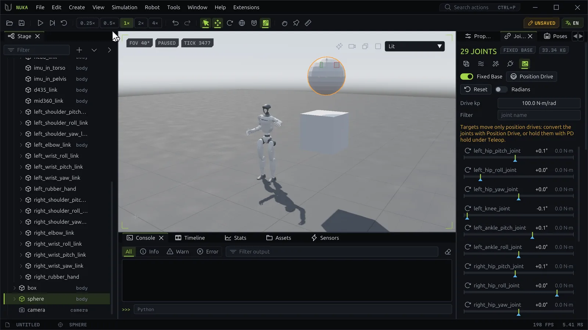

# Simulation



## Play, step, reset

| Command | Toolbar | Shortcut | Does |
| --- | --- | --- | --- |
| **Play/Pause** | ▶ / ❚❚ | ++space++ | Runs the simulation in real time, or pauses it |
| **Step** | ⏭ | | Advances a paused world by one physics step; `sim.step {steps: N}` by N |
| **Reset** | ⟲ | | Every environment back to the scene's initial state at tick 0, paused |
| **Speed** | 0.25× … 4× | | Slow motion below 1×; above 1× as fast as the machine keeps up |

The viewport's chips show the state (**PAUSED** or **LIVE**) and the **tick**, the count of physics steps
since the reset. The Stats panel shows how long each physics step takes and how many steps each frame ran.

The simulation is **deterministic**: the same scene, steps and inputs give bit-identical states.
`timeline.hash` returns a hash of the world's state to compare runs.

## Editing while it runs

You can keep editing while the simulation plays. Live fields (⚡ in Properties: mass, friction, gains,
damping, gravity, solver iterations and more) change at the next step. Moving a body with the gizmo
teleports it. Structural edits (adding, deleting, changing shapes or joint types) wait for **Apply &
Rebuild**, which rebuilds the world and carries the state over. See
[Building scenes](scene.md#the-properties-panel).

Where the robot starts after a reset is its *initial state*: the joint positions set in Properties, or a
pose made initial in the Poses panel ([Robots](robots.md#poses)).

## Time step

The **Solver** panel's **Time Step** buttons (1 ms, 2 ms, 1/240 s, 5 ms) set the physics step;
`sim.dt {seconds}` takes any value from 0.0001 to 0.05 s. A change rebuilds the world and keeps its state.
A loaded policy runs at the step it was trained at, so unload it before changing the step.

The **Sweep Budget** (10, 32, 128, 512) caps the solver's velocity sweeps per step; see
[Inspecting physics](inspect.md#the-solver-panel).

## Environments

`sim.envs {count}`, or **Count** and **Rebuild** under the viewport's **Environments** button, rebuilds the
world with that many environments (up to 4096), all simulating at once. The viewport draws up to 16 of
them in a grid; see [Viewport and camera](viewport.md#several-environments).

## Pushing things around

The toolbar's tools act on the shown environment while it simulates:

**Perturb**
:   Press on a body and drag: a spring pulls the grabbed point toward the pointer, and a label shows the
    force in newtons. Release to let go. Right-click the button to set the spring's **Stiffness**.
    On cloth and MPM solids the tool grabs a particle.

**Pin**
:   Click a free body to make it static where it stands, or a pinned one to let it move again. On cloth
    the click pins or unpins the vertex under the pointer. Each click is one undoable edit that rebuilds
    the world.

**Measure**
:   Click a link, or a joint origin while the joint axes show, then a second link or joint, or empty
    space for the ground. The viewport shows the distance and its components. Right-click the button to
    measure between link origins or centers of mass. `tool.measure_clear` clears it.

In the default **Select** tool, ++ctrl++ + left-drag on a body pulls it the same way without switching
tools.

The same loads are actions, for scripts and agents:

```python
app.actions.run("sim.perturb", path="/World/go2/base", force=[0, 80, 0])  # held until released
app.actions.run("sim.perturb", path="/World/box", target=[0.5, 0, 1.0])  # a spring toward a point
app.actions.run("sim.grab_particle", particle=120, target=[0, 0, 1])     # cloth or MPM
app.actions.run("sim.release")                                          # every load
```

`sim.loads` lists the loads held now.

## Who drives the robot

A robot's joints follow their **drive targets**. Several sources write them; the latest one wins:

- the Joints panel's sliders and `robot.set_targets`;
- a pose blend from the Poses panel;
- teleop, a running policy, a demonstration replay or a playing clip ([Teleop, policies, demos and
  clips](motion.md)).

A training run observed in the viewport drives the world from the trainer's frames; **Play** takes the
world back from the last frame shown ([Training](training.md#watching-a-run)).
