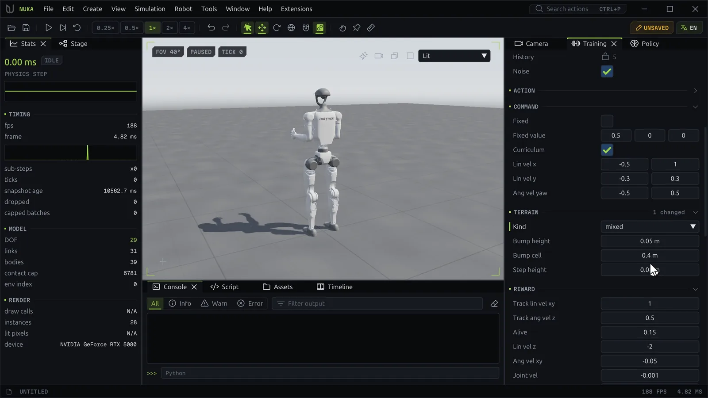
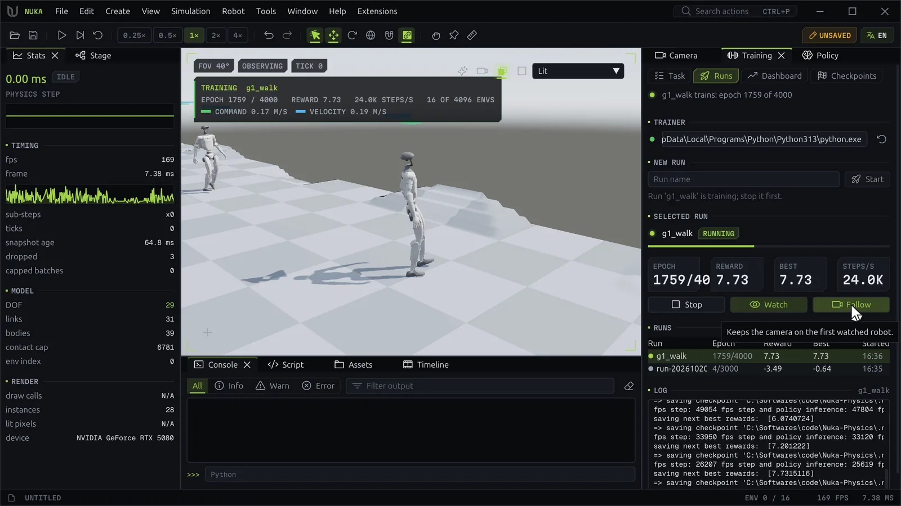
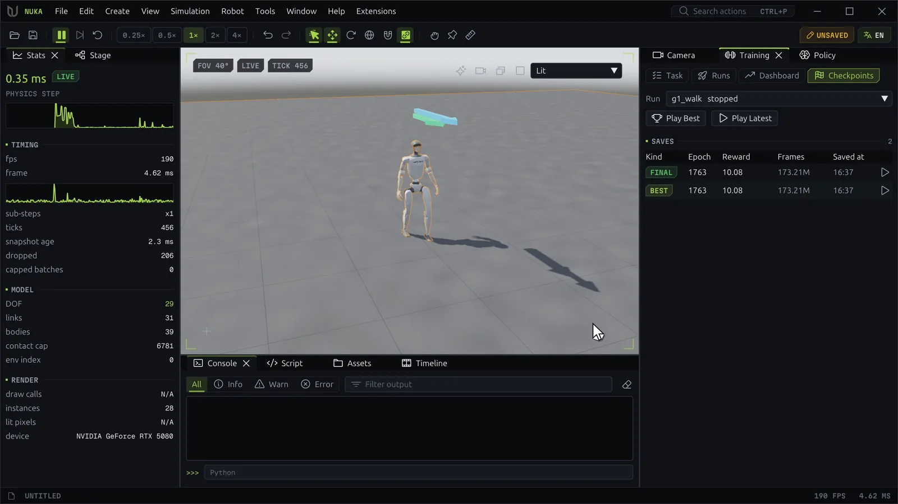

# Training

The **Training** panel trains a locomotion policy for the scene's robot with PPO (rl_games), in a
separate process, and brings the result back into the scene. The **Training** layout puts it on the
right with the Policy and Camera panels. Its four pages are **Task**, **Runs**, **Dashboard** and
**Checkpoints**; a line under the page tabs shows the run training now and its epoch.

## The task



**Task** picks what to train. Two tasks ship with the editor; extensions register more:

| Task | Id | Robot | Default run |
| --- | --- | --- | --- |
| **Go2 velocity tracking** | `go2_velocity` | Unitree Go2 | 1024 robots, 200 epochs, a save every 25 |
| **G1 rough-terrain walking** | `g1_rough` | Unitree G1 | 4096 robots, 3000 epochs, a save every 100 |

### A task of your own

The **+** beside the task (**New Task**, `train.new_task {from}`) starts a task of your own on top of the
one shown: a Python module `my_task.py` in the profile's `extensions/my_task` folder, opened in the
Script panel, and selected on the Task page. Its groups are the base task's plus a **Goal** group with
`goal.speed` (m/s) and `goal.turn` (rad/s). Each `Group` in the module is a section of the Task page and
each `Param` a row in it, so adding one and saving the file adds it to the page. Further tasks are named
`my_task_2`, `my_task_3` and so on.

```python
app.actions.run("train.new_task", **{"from": "g1_rough"})
app.actions.run("train.set", values={"goal.speed": 1.0})
```

### Settings

Hover the task for the robot it expects (one per environment) and the rate it steps at. The badge says
**Ready to train**, or counts the problems that keep the scene from training; each problem shows under
its row, or at the top when it concerns the scene.

The settings come in groups: **Run**, **Observation**, **Action**, **Command**, **Terrain** (G1),
**Reward**, **Termination**, **Event** and **Algorithm**. A group's header counts the values changed
from the defaults. Observation and action terms are read-only: their sizes and scales are the contract
the policy deploys under. In a row:

- hover the name for what it does, its default and its path;
- a bar left of the name marks a value off its default, red when it keeps the run from starting;
- right-click for **Reset to Default** and **Copy Path**.

The settings are kept per document in the editor's profile. `train.set` changes them from a script,
by their `group.key` paths:

```python
app.actions.run("train.set", task="go2_velocity",
                values={"run.num_envs": 2048, "run.max_epochs": 500, "event.randomize": True})
print(app.actions.run("train.validate"))
```

## Starting a run

The **Runs** page starts and lists the runs of this document.

### The Python it trains with

**Trainer** is the Python interpreter runs start in. It needs `torch`, `rl_games` 1.6.5 and a CUDA GPU;
the dot turns green when it has them, and the error says what is missing otherwise. Type a path and press
++enter++ to check it, or leave it empty for the editor's own; the button beside it checks again.
`train.python {path}` sets it from a script.

### New Run

Type a **Run name** (empty names it by the time) and press **Start**. The line below says how many
robots train for how many epochs. Start stays disabled, with the reason, while another run trains, the
Task page has problems or the Python can't train. One run trains at a time.

The run trains the scene as it stands, with the Task page's settings. `train.start {checkpoint}` resumes
from an rl_games checkpoint.

### Selected Run

The run picked in the **Runs** table shows its state (starting, running, done, failed or lost), a
progress bar and tiles for **Epoch**, **Reward**, **Best** and **Steps/s**. While it runs:

- **Stop** ends it after the current epoch, with a final save.
- **Watch** shows it in the viewport ([below](#watching-a-run)).
- **Follow** keeps the camera on the first watched robot.

The **Runs** table lists every run with its epoch, reward, best reward and start time. Right-click a run
for **Compare on Dashboard**, **Stop** and **Show in Folder**. The **Log** under it follows the run's
output.

## Watching a run



**Watch** streams 16 of the run's robots into the viewport as it trains, on its terrain, each under
arrows of its commanded and actual velocity. A plate over the viewport shows the run, the epoch, the
reward, the steps per second, how many environments are shown and the current robot's command and
speed.

While you watch, the viewport shows the trainer's frames instead of the editor's simulation. **Play**
takes the world back from the last frame shown.

```python
app.actions.run("train.observe", on=True, envs=16, follow=True)
```

## The dashboard

**Dashboard** plots the selected run's epochs: **Reward**, **Episode length**, **Actor loss**,
**Critic loss**, **Entropy**, **KL divergence**, **Steps per second** and **Learning rate**, two plots
abreast in a wide panel. Tiles add the frames trained and the time taken. **Compare with...** draws
other runs over it in their own colors; hover a plot for each run's value at that epoch. The **×** by a
run's name removes it from the comparison.

`train.metrics` returns the same rows, page by page.

## Checkpoints



**Checkpoints** lists the selected run's saves, newest first, each with its kind (**best**, **final** or
**epoch**), epoch, reward, frames and time. Every save has an rl_games checkpoint and an NKML policy
with its contract.

- **Play Best** loads the best save's policy onto the scene's robot and plays.
- **Play Latest** does the same with the newest save.
- The play button on a row plays that save; right-click it for **Copy Policy Path**.

The loaded policy then shows in the [Policy panel](motion.md#policies), where teleop steers it.

## Run folders

Runs live in the editor's profile under `runs/<document key>/<run name>/`. **Show in Folder** opens one.

```text
job.json            the task, configuration and scene the run trains
status.json         state, epoch, rewards, the port viewers watch it through
metrics.jsonl       a row per epoch
checkpoints.jsonl   a row per save
log.txt             the trainer's output
nn/*.pth            rl_games checkpoints
policies/*.nkml     the policies, each with its .contract.json
```

A run can also start outside the editor: `python -m nuka.train <folder>/job.json`. A file named `stop`
in the folder ends it after the current epoch.
